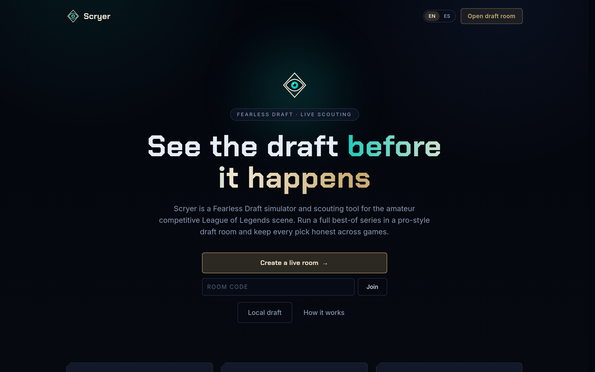
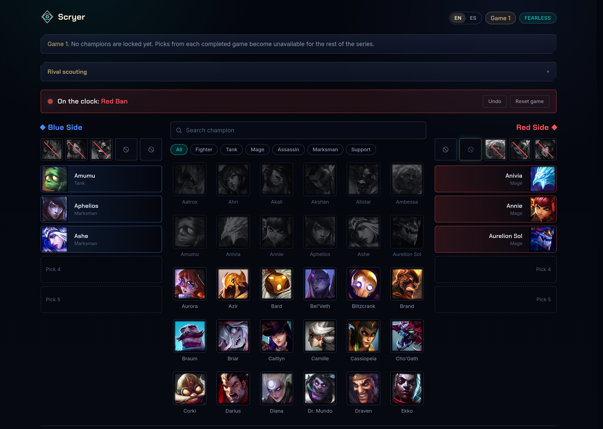
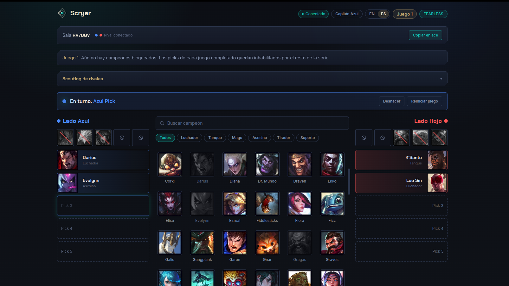
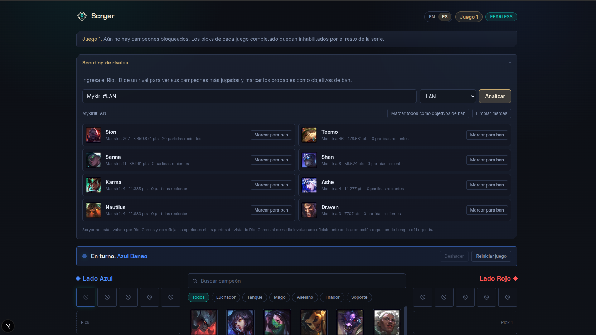

# Scryer

[](https://github.com/Sagudelo01/scryer/actions/workflows/ci.yml)

Scryer is a Fearless Draft tool for the amateur competitive League of Legends
scene. It gives community tournaments, scrim teams and aspiring coaches a
pro-style draft room: draft a full best-of series in one place with the Fearless
ruleset enforced automatically, run it live across two captains, and scout a
rival's champion pool before you ban.

The name comes from "scry" — to see what is hidden, in advance. That is the idea
behind the project: reading the draft before it happens.

## Features

- **Fearless Draft board.** Draft a full series with the standard competitive
  ban and pick order. Every champion picked in an earlier game is locked out for
  the rest of the series. Works locally with no setup.
- **Live rooms.** Create a room with a short code and share the link. Two
  captains draft in real time while spectators watch read-only, synced through
  Supabase Realtime. Only the captain whose turn it is can act, and that rule is
  enforced in the database, not just the interface.
- **Rival champion scouting.** Enter a Riot ID and region to see a rival's most
  mastered champions, with how often each one shows up in their recent games.
  Flag champions as ban targets and they are highlighted right in the draft grid.
- **English and Spanish.** A language switch translates the interface and the
  champion names, loading the matching Data Dragon locale. The choice is saved
  and defaults to the browser language.
- **Responsive, competitive design.** A dark hextech-inspired interface that
  works from phone to ultrawide.

## Screenshots

Add images under `docs/` and they will render here. Suggested captures:

- `docs/landing.png` — the landing page.
- `docs/draft-board.png` — the local draft board partway through a game.
- `docs/live-room.png` — a live room showing the room code, role and connection.
- `docs/scouting.png` — the scouting panel open with ban targets highlighted in
  the grid.

<!--  -->
<!--  -->
<!--  -->
<!--  -->

## Tech stack

- [Next.js](https://nextjs.org) (App Router) and TypeScript
- [Tailwind CSS](https://tailwindcss.com)
- [Supabase](https://supabase.com) (Postgres and Realtime) for live rooms and
  anonymous authentication
- Riot [Data Dragon](https://developer.riotgames.com/docs/lol#data-dragon) for
  champion data and images, and the Riot Games API (Account-V1,
  Champion-Mastery-V4, Match-V5) for scouting
- [Zod](https://zod.dev) for validating external data and shared state
- [Vitest](https://vitest.dev) for unit tests, with GitHub Actions for CI
- Deployed on [Vercel](https://vercel.com)

## Getting started

Requirements: Node.js 20 or newer and npm.

```bash
npm install
npm run dev
```

Open [http://localhost:3000](http://localhost:3000). The local draft board lives
at [http://localhost:3000/draft](http://localhost:3000/draft) and needs no
configuration. Live rooms and scouting are optional and only need the
environment variables below.

Scripts:

```bash
npm run build       # production build
npm run start       # run the production build
npm run lint        # lint the project
npm run typecheck   # type-check without emitting
npm test            # run the unit tests
```

## Environment variables

Copy the example file and fill in the values you want. Everything works locally
without it; each variable only enables its feature.

```bash
cp .env.example .env.local
```

| Variable                        | Enables    | Notes                                  |
| ------------------------------- | ---------- | -------------------------------------- |
| `NEXT_PUBLIC_SUPABASE_URL`      | Live rooms | Supabase project URL                   |
| `NEXT_PUBLIC_SUPABASE_ANON_KEY` | Live rooms | Supabase anon public key               |
| `RIOT_API_KEY`                  | Scouting   | Server only, never sent to the browser |

## Live rooms (Supabase)

1. Create a project at [supabase.com](https://supabase.com).
2. In Authentication, enable **Anonymous sign-ins**.
3. In the SQL Editor, run
   [`supabase/migrations/0001_init.sql`](supabase/migrations/0001_init.sql). It
   creates the `rooms` table, enables row level security, installs the
   authoritative draft functions and adds the table to the realtime publication.
4. Copy the Project URL and anon key (Project Settings > API) into `.env.local`.
5. For deployment, add the same two variables in the Vercel project settings and
   redeploy.

Every draft mutation goes through `SECURITY DEFINER` database functions that
check turn ownership and the Fearless rule, so only the captain whose turn it is
can act. Row level security blocks direct writes to the table.

## Scouting (Riot API)

1. Generate a development API key at
   [developer.riotgames.com](https://developer.riotgames.com).
2. Add it to `.env.local` as `RIOT_API_KEY`.
3. For deployment, add `RIOT_API_KEY` in the Vercel project settings and
   redeploy.

The key is read only inside the server route at `src/app/api/scouting` and never
reaches the browser. Responses are cached with sensible TTLs, the request rate is
limited, and rate-limit responses are retried using the `Retry-After` header.

## Project structure

```
src/
  app/            Routes: landing, /draft, /room/[code], /api/scouting
  components/     UI for brand, draft, rooms, scouting, landing and i18n
  hooks/          Draft state, realtime room and ban-target hooks
  lib/
    draft-engine.ts  Fearless draft state machine (pure, framework-agnostic)
    room.ts          Room roles and turn permissions
    scouting.ts      Champion mastery and recent-games aggregation
    ddragon.ts       Data Dragon loader
    i18n.ts          English/Spanish dictionary
    riot/            Riot API client, regions and schemas
    supabase/        Browser client and anonymous auth
    schemas.ts       Zod schemas
supabase/migrations/ Versioned SQL (schema, RLS, draft functions)
```

## Quality

The draft logic (`src/lib/draft-engine.ts`), the room turn and permission rules
(`src/lib/room.ts`) and the scouting aggregation (`src/lib/scouting.ts`) are pure
and covered by Vitest. External Data Dragon and Riot API responses, the draft
state and the data returned by Supabase are validated with Zod. Every push and
pull request runs lint, type-check, tests and a production build through GitHub
Actions.

## Legal

Scryer is not endorsed by Riot Games and does not reflect the views or opinions
of Riot Games or anyone officially involved in producing or managing League of
Legends. League of Legends and Riot Games are trademarks or registered
trademarks of Riot Games, Inc. League of Legends is a copyright of Riot Games,
Inc.

Champion data and images are provided through Riot's Data Dragon static data
service. No Riot Games logos or branding are used in this project.

## License

Released under the [MIT License](LICENSE).
